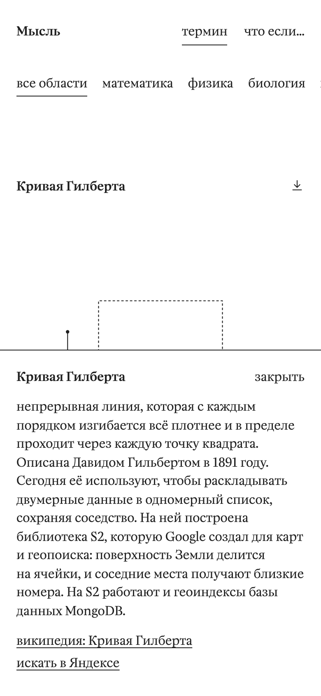
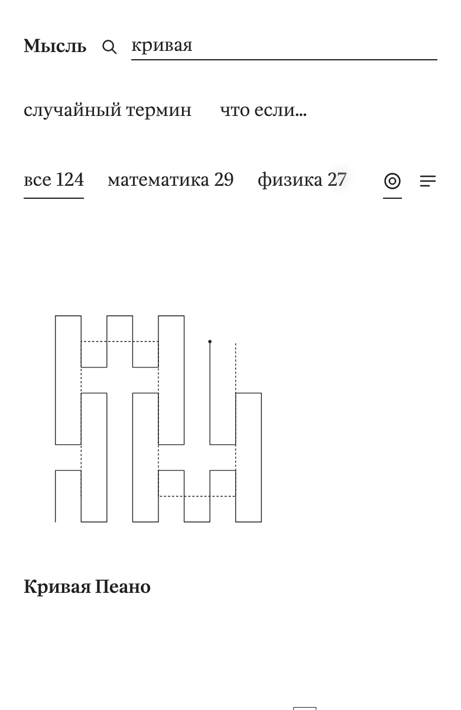
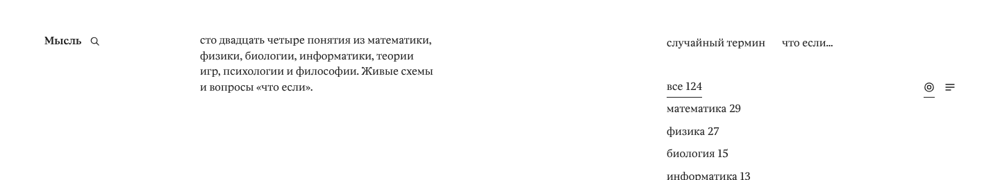
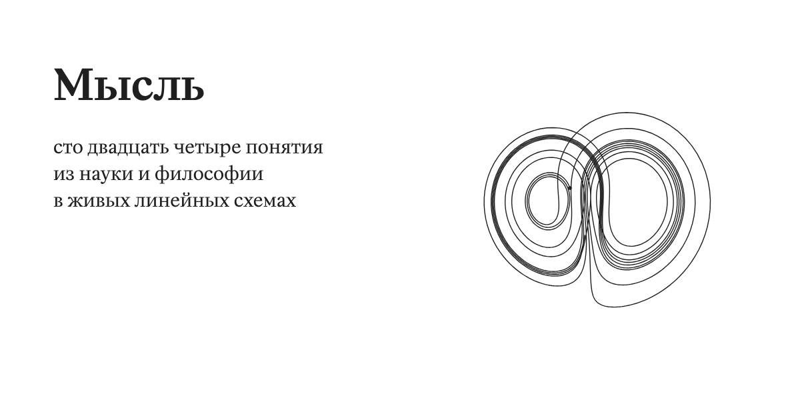
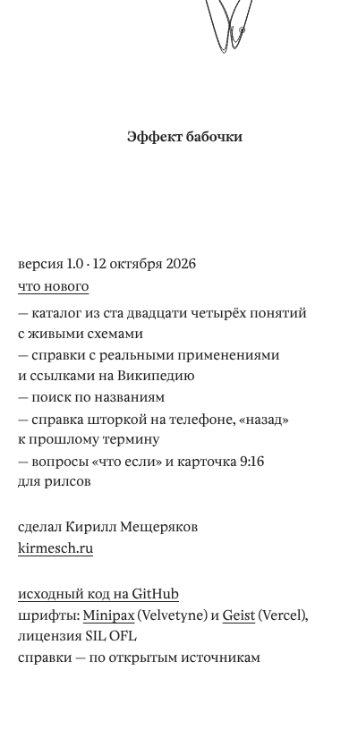
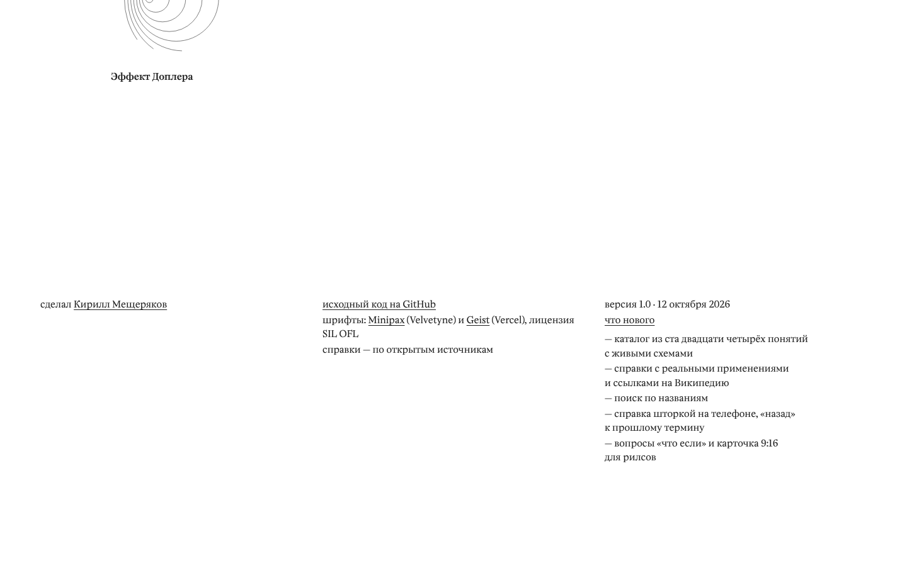
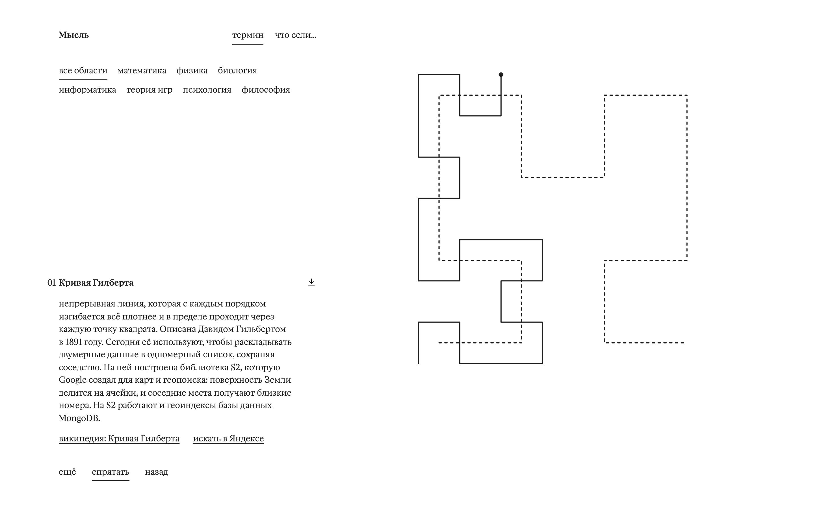
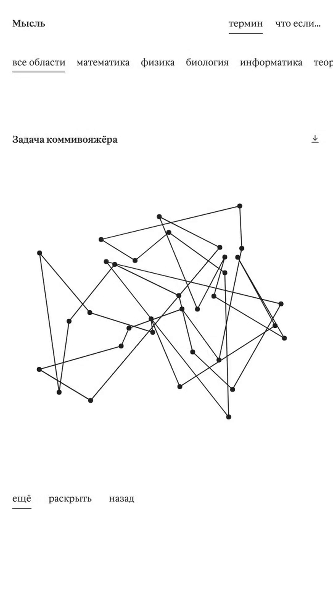
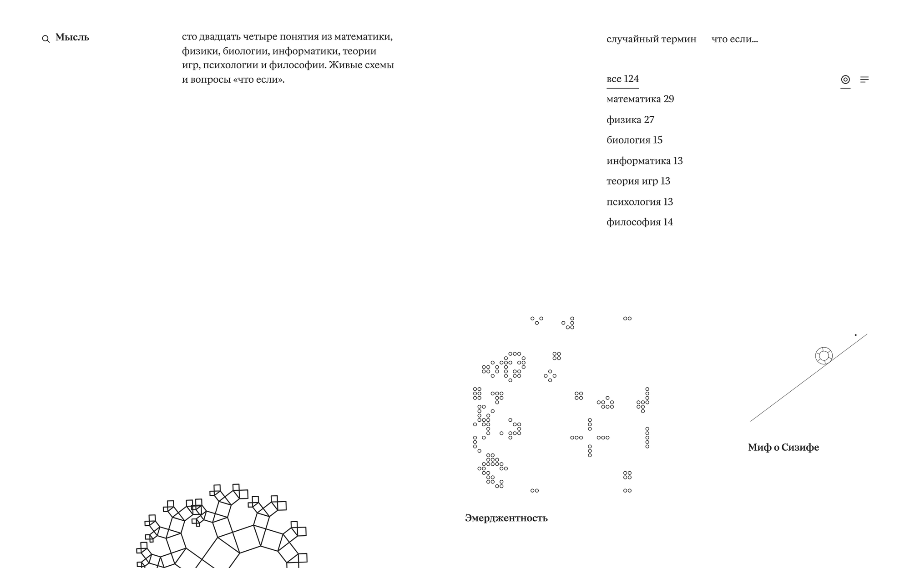
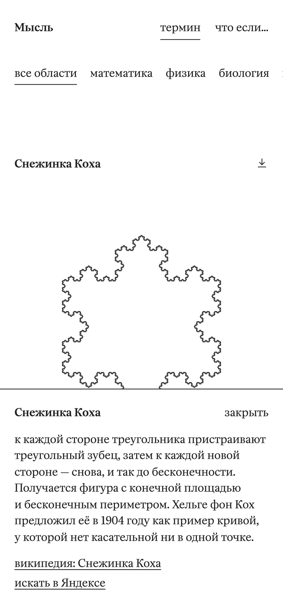

# lab

## Мета

## Проблема и контекст

## Решения

## Неожиданные моменты

### 2026-10-12T14:00 (сессия 7ca56445)
**Raw**
- Read `/home/user/lab/mind/js/app.js` — 455 console.error(e);
- Bash `sed -i 's/.search::placeholder { color: var(--ink); opacity: .45; }/.search::placeholder { color: var(--ink); opacity: 1; } \/* без полутонов *\//' style.css && cat > /tmp/claude-0/-home-user-lab/7ca56445-22cd-5f32-8daf-…` — triggerUncaughtException(err, true /* fromPromise */);
- Bash `python3 - <<'EOF' import pathlib p=pathlib.Path('js/catalog.js'); t=p.read_text() for a,b in [("hay: norm(`${t.title} ${t.area} ${t.ref}`)","hay: norm(t.title)"), (""" if (query.length) shown.sort((x, y) => titleHit(y…` — Exit code 144
- Bash `cd /home/user/lab/mind && cat icon.svg; echo; python3 -c "import fontTools, brotli; print('ft ok', fontTools.version)" 2>&1; grep -rn "otf\|woff2" index.html style.css js | head` — Traceback (most recent call last):
- Bash `S=/tmp/claude-0/-home-user-lab/7ca56445-22cd-5f32-8daf-92746678ec59/scratchpad && cp $S/og_lorenz_20.png og.png && cp $S/apple-touch-icon.png apple-touch-icon.png && rm _og.html icon_tmp.html && ls -la og.png apple-touch…` — 404/ошибки: []
- Bash `git fetch -q origin main && git checkout -q -B e-kir/peaceful-wright-a2thgu origin/main && cd mind && python3 - <<'EOF' import pathlib,re p=pathlib.Path('index.html'); t=p.read_text() s=t.index(' <footer class="foot">')…` — Exit code 144
- Bash `cd /home/user/lab/.zhatva/cases/lab && cat case-study.md; ls -la media; git -C /home/user/lab status --short | head; git -C /home/user/lab check-ignore -v .zhatva 2>&1` — - Read `/home/user/lab/mind/js/app.js` — 455 console.error(e);
- Write `/home/user/lab/mind/README.md` — PreToolUse:Write hook error: [Fact-Forcing Gate]
- Bash `node --input-type=module -e " import {TERMS} from './js/data/terms.js'; const g={};for(const t of TERMS)(g[t.engine]??=[]).push(t.title+(t.params?.mode?'['+t.params.mode+(t.params.rule?t.params.rule:'')+']':'')); for(con…` — symbol: Золотое сечение[golden]; Отель Гильберта[hotel]; Лента Мёбиуса[mobius]; Кот Шрёдингера[schrodinger]; Ошибка невозвратных затрат[stack]; Когнитивный диссонанс[dissonance]; Апофения[apophenia]; Эффект Даннинга — Кр…
- Write `/home/user/lab/README.md` — PreToolUse:Write hook error: [Fact-Forcing Gate]
- Write `/home/user/lab/.claude/skills/minimal-typographic-design/SKILL.md` — PreToolUse:Write hook error: [Fact-Forcing Gate]
- Bash `cd /home/user/lab/.zhatva/cases/lab && grep -rniE "gmail|@[a-z0-9-]+\.[a-z]{2,}|token|secret|password|api[_-]?key|sk-[a-z0-9]{10,}|ghp_|/root/" case-study.md case-study.html state.json media/index.json | cut -c1-160 | he…` — "summary": "Read `/home/user/lab/mind/js/app.js` — 455\t console.error(e);"

## Витрина

### Изображения

### Видео

[Видео](media/2026-11-27-0c8f.mp4)

## Польза

## Уроки
