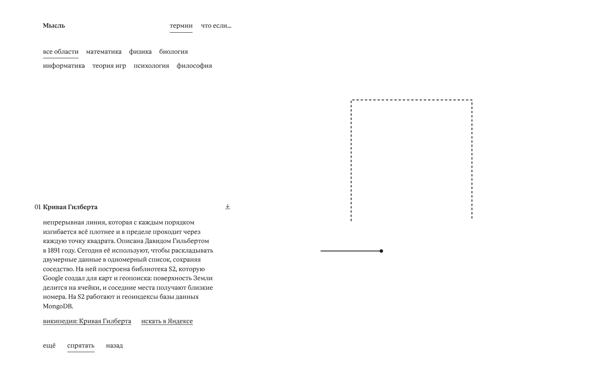
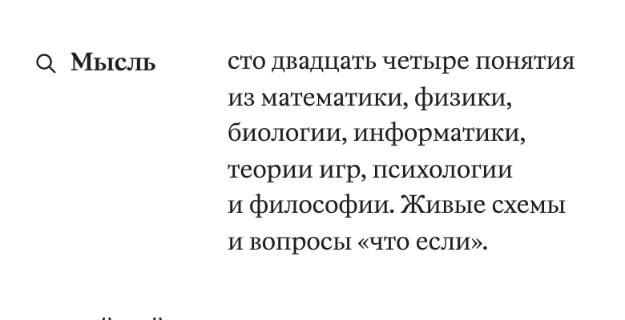
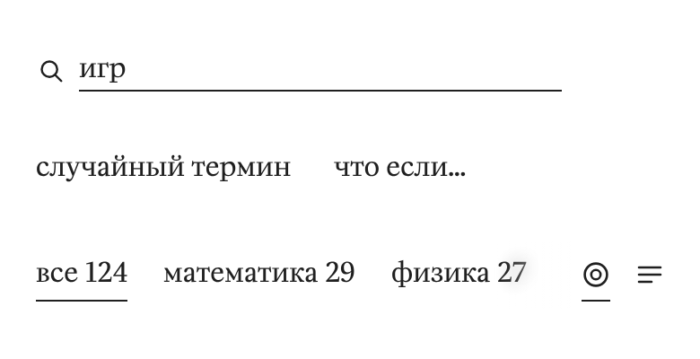
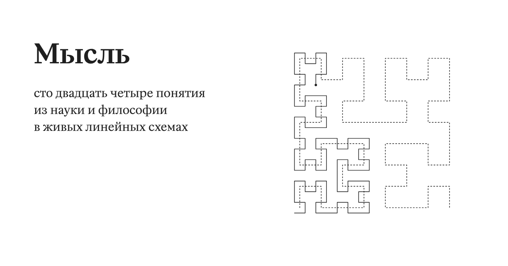
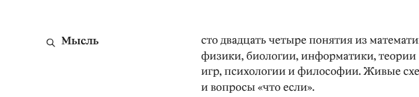
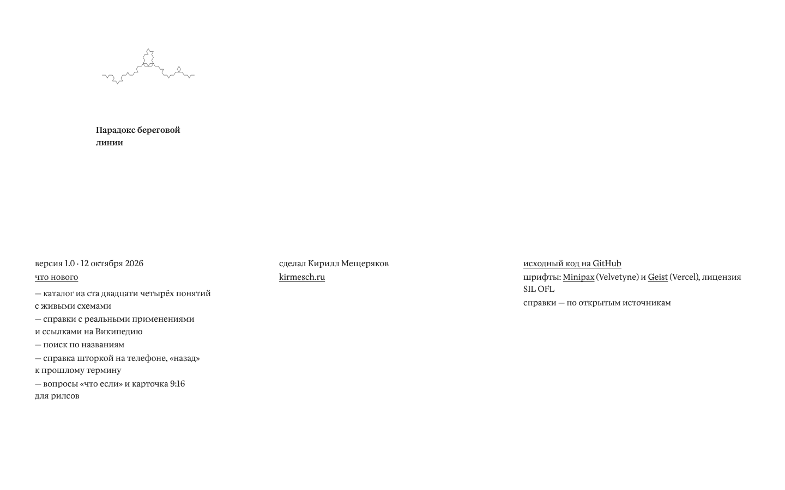

# lab

## Мета

## Проблема и контекст

## Решения

## Неожиданные моменты

### 2026-10-12T14:00 (сессия 7ca56445)
**Raw**
- Read `/home/user/lab/mind/js/app.js` — 455 console.error(e);
- Bash `sed -i 's/.search::placeholder { color: var(--ink); opacity: .45; }/.search::placeholder { color: var(--ink); opacity: 1; } \/* без полутонов *\//' style.css && cat > /tmp/claude-0/-home-user-lab/7ca56445-22cd-5f32-8daf-…` — triggerUncaughtException(err, true /* fromPromise */);
- Bash `python3 - <<'EOF' import pathlib p=pathlib.Path('js/catalog.js'); t=p.read_text() for a,b in [("hay: norm(`${t.title} ${t.area} ${t.ref}`)","hay: norm(t.title)"), (""" if (query.length) shown.sort((x, y) => titleHit(y…` — Exit code 144
- Bash `cd /home/user/lab/mind && cat icon.svg; echo; python3 -c "import fontTools, brotli; print('ft ok', fontTools.version)" 2>&1; grep -rn "otf\|woff2" index.html style.css js | head` — Traceback (most recent call last):
- Bash `S=/tmp/claude-0/-home-user-lab/7ca56445-22cd-5f32-8daf-92746678ec59/scratchpad && cp $S/og_lorenz_20.png og.png && cp $S/apple-touch-icon.png apple-touch-icon.png && rm _og.html icon_tmp.html && ls -la og.png apple-touch…` — 404/ошибки: []
- Bash `git fetch -q origin main && git checkout -q -B e-kir/peaceful-wright-a2thgu origin/main && cd mind && python3 - <<'EOF' import pathlib,re p=pathlib.Path('index.html'); t=p.read_text() s=t.index(' <footer class="foot">')…` — Exit code 144

## Витрина

### Изображения

## Польза

## Уроки
