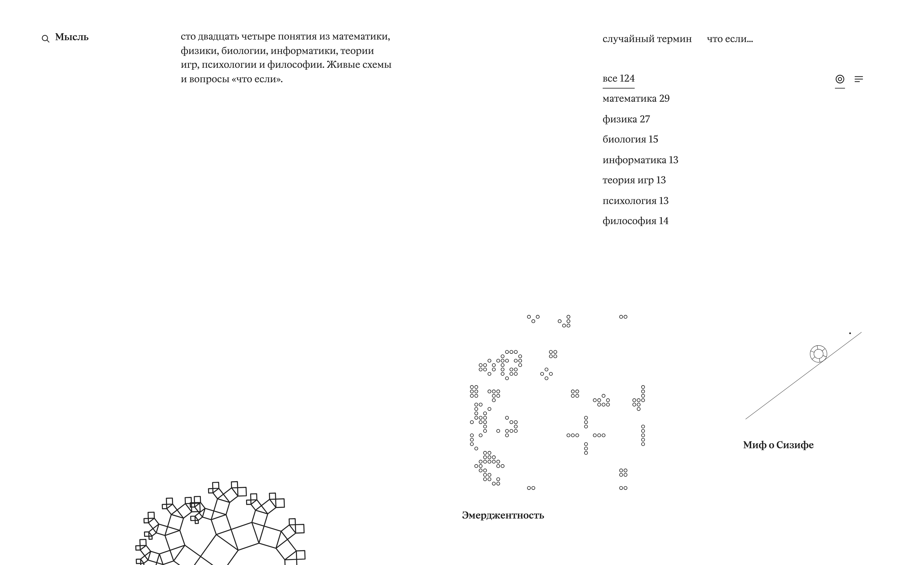
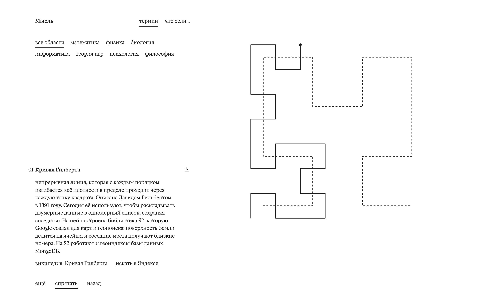
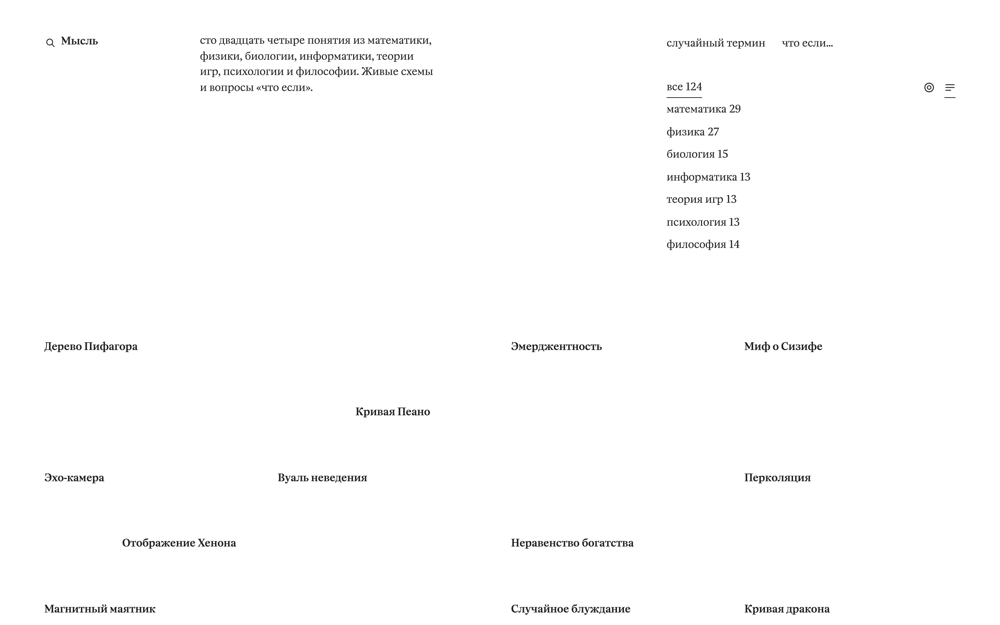
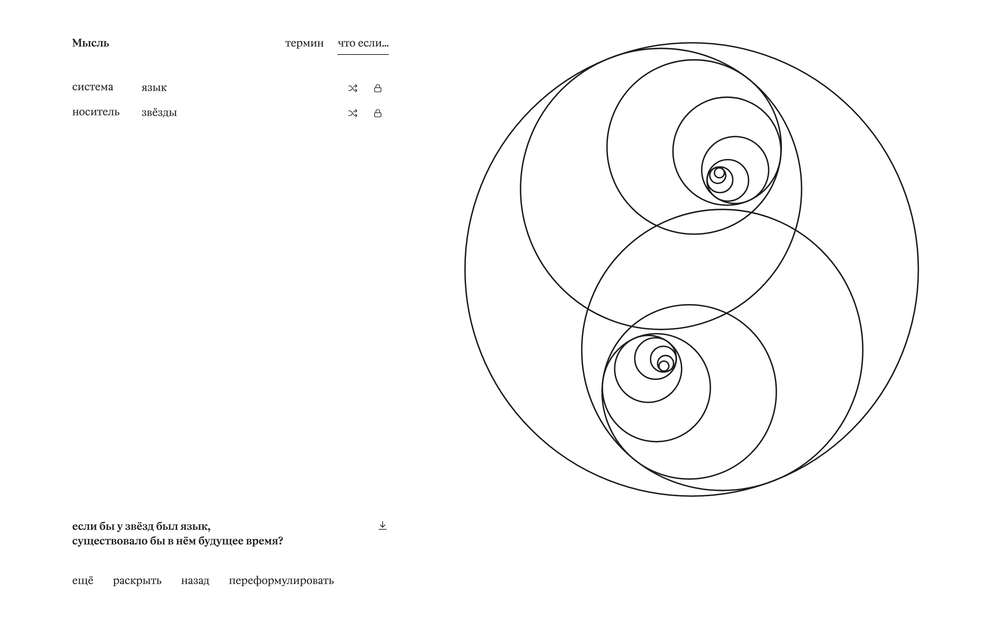
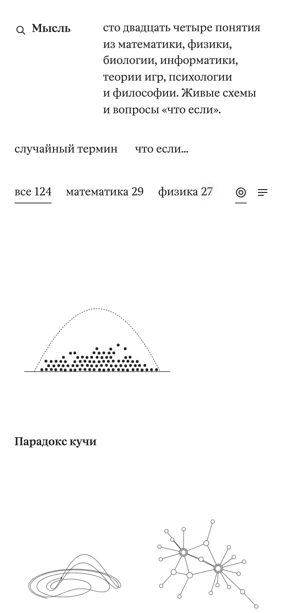
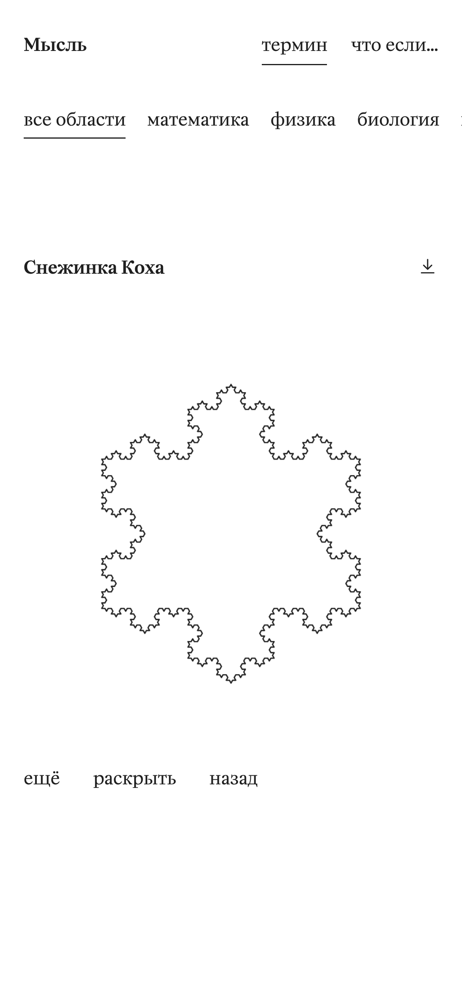
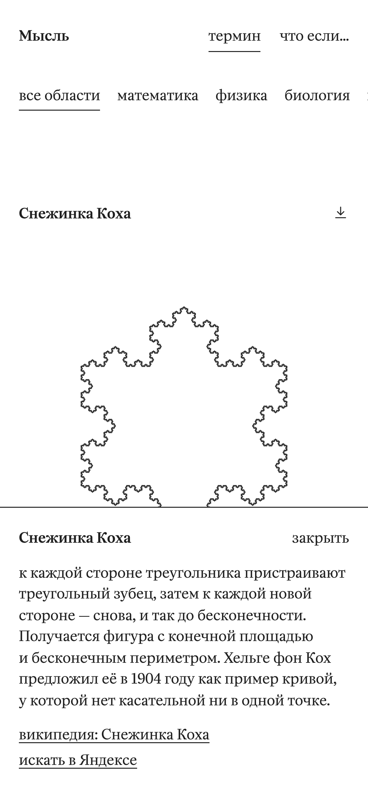
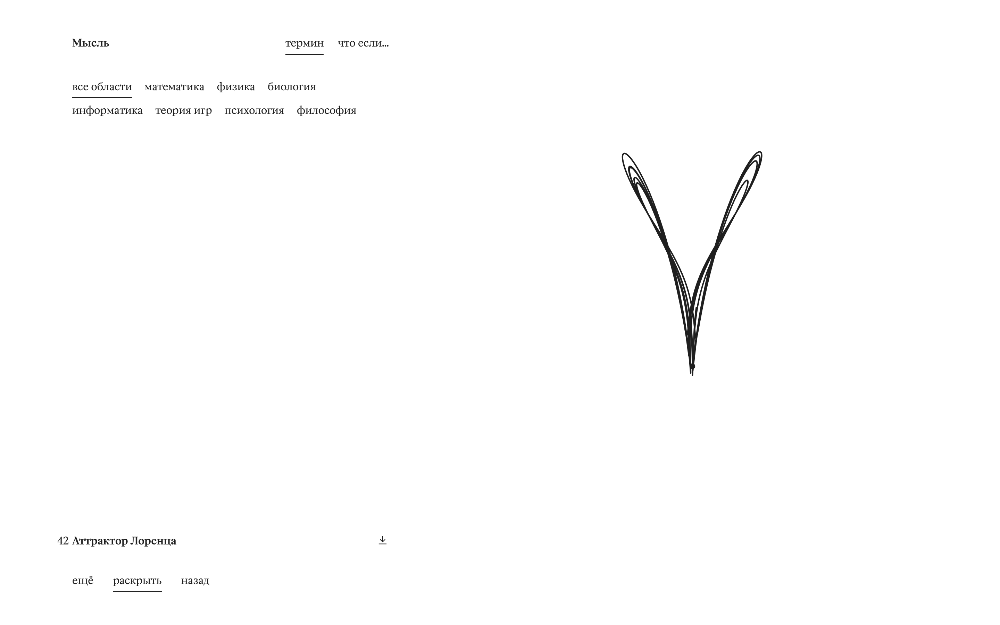

<div align="center">

# Мысль · *Mysl'*

**A living catalogue of 124 ideas from science and philosophy, drawn as single-line animated diagrams.**

Press *next* and a new concept appears — a Hilbert curve filling a square, a Lorenz attractor tracing its wings, a prisoner's dilemma playing itself out. Nothing is a picture: every diagram is a small simulation running on a `<canvas>`.

[**Open the live site →**](https://create.kirmesch.ru/mind/)


</div>

> The interface and all reference texts are in Russian. This page is the English guide to the project.

---

## What it is

*Mysl'* ("Thought") is a generator and catalogue for terms from mathematics, physics, biology, computer science, game theory, psychology and philosophy. Each term has:

- a **live diagram** — drawn with one thin line, no fills, no colour, simulated in real time;
- a short **reference text** with dates, names and, where it is true and checkable, a real-world use (the Hilbert curve underlies Google's S2 geometry library; cosine transforms sit inside JPEG and MP3; Lagrange point L2 hosts the James Webb telescope);
- a **deep link** (`#t/hilbert`) so any concept can be shared.

A second mode, **"what if…"**, assembles open-ended questions from a system and a carrier and pairs each with a procedurally generated symbolic diagram. A **9:16 card exporter** renders the current frame to a 1080×1920 PNG for social media.

It started as a side project and a way to make short educational reels; it grew into a small design-engineering exercise in how much can be said with one line and one text size.

## Screens

<table>
<tr>
<td width="50%"><br><sub><b>Catalogue.</b> Terms in a loose, shuffled grid; every tile is animated. The number fades in on hover.</sub></td>
<td width="50%"><br><sub><b>Term page.</b> Name, reference text and links on the left; the diagram on the right.</sub></td>
</tr>
<tr>
<td><br><sub><b>Text view.</b> The same catalogue as a typographic index.</sub></td>
<td><br><sub><b>"What if…"</b> Questions built from a system × carrier pair.</sub></td>
</tr>
</table>

<table>
<tr>
<td width="25%"></td>
<td width="25%"></td>
<td width="25%"></td>
<td width="25%"></td>
</tr>
<tr>
<td align="center"><sub>Mobile catalogue</sub></td>
<td align="center"><sub>Mobile term</sub></td>
<td align="center"><sub>Reference as a bottom sheet</sub></td>
<td align="center"><sub>Lorenz attractor</sub></td>
</tr>
</table>

A 43-second vertical walkthrough made for reels is in [`docs/reel-9x16.mp4`](docs/reel-9x16.mp4).

## What was built

| Area | Details |
|---|---|
| **8 simulation engines** | `curves` (Hilbert, Peano, Moore, Gosper and dragon curves, Z-order, Ulam spiral, Collatz, Fourier epicycles…), `fractals` (Mandelbrot, Julia, Koch, Sierpiński, Pythagoras tree, Lévy curve, L-systems, Barnsley fern…), `automata` (Game of Life, rules 30 / 90 / 110 / 184, Langton's ant, Ising model, sandpile, Turing machine, Schelling segregation…), `particles` (diffusion, Brownian motion, Maxwell's demon, boids, Galton board, stigmergy…), `waves` (interference, standing waves, Chladni figures, beats, Doppler, moiré…), `chaos` (double pendulum, Lorenz and Rössler attractors, butterfly effect, three-body problem, logistic map…), `graphs` (small world, Königsberg bridges, PageRank, travelling salesman, Braess paradox, payoff matrices…), `symbol` (arches, orbits, spirals, monograms, the Sisyphus stone…). |
| **124 terms** | 29 mathematics · 27 physics · 15 biology · 13 computer science · 13 game theory · 13 psychology · 14 philosophy. Each has a hand-written reference text. |
| **"What if…" generator** | 14 systems × 12 carriers with grammatical-gender agreement, so Russian questions read naturally. |
| **Catalogue** | Rhythmic grid that differs per breakpoint (6 / 8 / 12 columns); lazy simulation — only visible tiles run; one visual shared between a tile and its term page; [View Transitions](https://developer.mozilla.org/docs/Web/API/View_Transition_API) between screens; title-only search; area filters. |
| **Mobile** | Reference text as a swipe-to-dismiss bottom sheet, history-aware *back* button, touch-first layout. |
| **Card export** | The very same `draw()` renders into a 1080×1920 canvas with proportional line width; there is no separate "export" artwork. |
| **Typography** | Russian typographic rules applied automatically: no hanging prepositions or conjunctions at line ends, non-breaking space before a dash, lower-case body text with capitalised terms. |
| **Publishing hygiene** | Open Graph card, canonical URL, woff2 fonts with preload, per-term `<title>`. |

## How it works

```
mind/
├─ index.html · style.css          one page, no framework, one text size (15 px)
└─ js/
   ├─ app.js                       state, routing (#t/…, #w/…), history, reveal sheet, card export
   ├─ catalog.js                   grid, search, filters, lazy tile simulation
   ├─ card.js                      9:16 PNG exporter
   ├─ core/                        seeded rng, drawing primitives, Russian typography
   ├─ engines/                     eight engines behind one contract (below)
   └─ data/                        terms, reference texts, "what if" systems and carriers
```

Every engine implements the same three functions, which is what lets one diagram live in a catalogue tile, a full page and a PNG:

```js
export default {
  create(params, rng) { /* → state */ },
  step(state, dt)     { /* advance the simulation */ },
  draw(ctx, state, box, style) { /* render into a unit square */ },
};
```

Drawing happens in a **unit square scaled to any size**, so line weight is a fraction of the diagram (`0.003`) and the card export looks like what is on screen. Randomness is seeded from the term id, so a term always starts the same way.

## Design principles

- **One line, one colour.** `#1F1F1F` on white. No fills, shadows or gradients — only outlines, dashes and dots.
- **One text size.** Everything is 15 px. Hierarchy comes from weight, underline and position only.
- **Two typefaces.** [Minipax](https://velvetyne.fr/fonts/minipax/) for all interface text; [Geist](https://vercel.com/font) for the tiny labels *inside* diagrams, scaled with the drawing rather than with the page.
- **A grid that breathes.** Large white space, uneven rhythm, numbers and chrome that appear only when needed.

## Run it locally

No build step, no dependencies.

```bash
git clone https://github.com/meschc/lab.git
cd lab
python3 -m http.server 8000
# open http://localhost:8000/mind/
```

Deep links: `#t/<term-id>` for a term (for example `#t/lorenz`) and `#w/<system>/<carrier>/<n>` for a "what if" question.

## Stack

Vanilla JavaScript (ES modules) · Canvas 2D · CSS Grid · View Transitions API · hosted on GitHub Pages. About 8,000 lines, zero runtime dependencies.

## Roadmap

- A new term every week, with a matching short reel (graph-theory results in logistics are next).
- One-click video export of the current diagram, not just a still card.
- Interactive terms: drag a pendulum, pick a seed, pose your own "what if".

## Credits

Built by [Kirill Mescheryakov](https://kirmesch.ru). Fonts: Minipax by [Velvetyne](https://velvetyne.fr/) and Geist by [Vercel](https://vercel.com/font), both under the SIL Open Font License. Reference texts are written from open sources.
